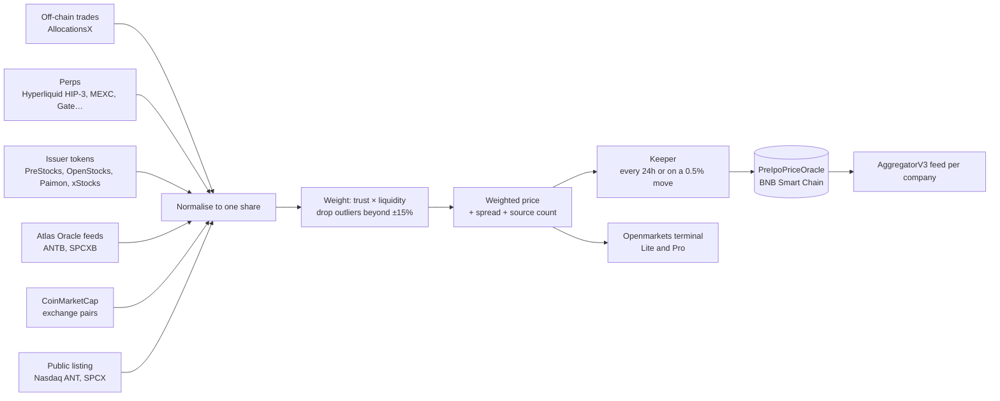

<p align="center">
  
</p>

<h1 align="center">Openmarkets</h1>

<p align="center"><strong>One trusted price per share for pre-IPO companies, published on BNB Chain.</strong></p>

<p align="center">
  Built for the BNB Chain Hackathon · Oracle live on BNB Smart Chain mainnet ·
  <a href="https://bscscan.com/address/0xA980e3C24759adFf55636512Ee1708bbFC91f65B">PreIpoPriceOracle on BscScan</a>
</p>

---

## The problem

Private companies like OpenAI, Anduril, Databricks and Polymarket now trade on-chain long before they go public, but every venue prices them differently:

- **Perpetuals** (Hyperliquid HIP-3 deployers, MEXC, Gate, Aster…) quote a share price, a valuation in billions, or an unstated unit.
- **Issuer tokens** (PreStocks, OpenStocks, xStocks, Paimon, bStocks) each wrap shares their own way: one share, ten shares, or an SPV claim.
- **Off-chain secondary trades** set the reference price, but they never reach a smart contract.
- **After an IPO**, pre-IPO tokens trade at a lock-up discount to the listed stock, and nothing explains why.

So a DeFi protocol on BNB Chain that wants to lend against, settle, or index a pre-IPO token has no single, explainable price to read.

## The solution

Openmarkets reads every one of those sources, puts each on the same one-share basis, weights it by how much it can be trusted and how liquid it is, and pushes the result to an on-chain oracle on **BNB Chain** with a Chainlink-compatible feed per company. Around that oracle sits a full market terminal, so anyone can see exactly where each number comes from and trade the BNB Chain tokens directly.



## Live on BNB Smart Chain (chain 56)

| Contract | Address |
|---|---|
| **PreIpoPriceOracle** | [`0xA980e3C24759adFf55636512Ee1708bbFC91f65B`](https://bscscan.com/address/0xA980e3C24759adFf55636512Ee1708bbFC91f65B) |
| ANTHROPIC / USD | [`0xC1B78E77d6382A89f1a59b8e604179FE73A882B0`](https://bscscan.com/address/0xC1B78E77d6382A89f1a59b8e604179FE73A882B0) |
| OPENAI / USD | [`0xc0F8090E4e5cBD2CB075Ea2336ee7fc6bA9d8391`](https://bscscan.com/address/0xc0F8090E4e5cBD2CB075Ea2336ee7fc6bA9d8391) |
| SPACEX / USD | [`0x5FDA2444235c6364Def4183Ca3ab371014E35ecC`](https://bscscan.com/address/0x5FDA2444235c6364Def4183Ca3ab371014E35ecC) |
| ANDURIL / USD | [`0xb5e92d90e5B881b18fBbFF8fCF70c22b969Ea30B`](https://bscscan.com/address/0xb5e92d90e5B881b18fBbFF8fCF70c22b969Ea30B) |
| NEURALINK / USD | [`0xABF6a9AAEBBC99a7a40D56b1549Db6dCc8CeE6f0`](https://bscscan.com/address/0xABF6a9AAEBBC99a7a40D56b1549Db6dCc8CeE6f0) |
| DATABRICKS / USD | [`0x35E28a4533662034E4B0E02F9db0F4e72Ed3c3e2`](https://bscscan.com/address/0x35E28a4533662034E4B0E02F9db0F4e72Ed3c3e2) |
| FIGUREAI / USD | [`0x9506390DC49617cE98be026742b2A71DcC2a34EC`](https://bscscan.com/address/0x9506390DC49617cE98be026742b2A71DcC2a34EC) |
| KALSHI / USD | [`0xf27d773ae904a0775b9d1D2b884673F3E64290Db`](https://bscscan.com/address/0xf27d773ae904a0775b9d1D2b884673F3E64290Db) |
| POLYMARKET / USD | [`0x3e724feE0248566D0E9C98f01629C771A89a5581`](https://bscscan.com/address/0x3e724feE0248566D0E9C98f01629C771A89a5581) |
| OURA / USD | [`0x6085eB490B9196B2fDefaa00c5D61ECD1c079e5c`](https://bscscan.com/address/0x6085eB490B9196B2fDefaa00c5D61ECD1c079e5c) |

**Update rule:** each feed is pushed every **24 hours**, or sooner when its live price moves **0.5%** from the on-chain price. The keeper checks every 5 minutes, and a feed counts as stale after 25 hours.

### Read a price from your contract

Every feed speaks Chainlink's `AggregatorV3Interface`, so existing DeFi code can use it unchanged:

```solidity
import {AggregatorV3Interface} from "./AggregatorV3Interface.sol";

contract UsesOpenmarkets {
    AggregatorV3Interface constant ANTHROPIC_USD =
        AggregatorV3Interface(0xC1B78E77d6382A89f1a59b8e604179FE73A882B0);

    function anthropicPrice() external view returns (int256 price, uint256 updatedAt) {
        (, price, , updatedAt, ) = ANTHROPIC_USD.latestRoundData(); // 8 decimals
    }
}
```

## How the price is built

1. **Collect** every quote for a company: off-chain trades, perps, exchange spot, issuer tokens, Atlas Oracle aggregates, CoinMarketCap exchange pairs and, once listed, the public share price.
2. **Normalise to one share.** Perps that quote a valuation are divided by the company's share count; multi-share tokens are divided down (one oANTHROPIC = 10 ANT shares); anything whose unit can't be established is shown but never averaged in.
3. **Weight** each source by **trust × popularity**:
   - *Trust* by source class: public listing 0.95, off-chain 0.85, Atlas 0.75, perps 0.70, xStocks 0.55, PreStocks 0.50, exchange spot 0.45, OpenStocks / Paimon 0.40. It is reduced for rescaled (×0.8) or inferred (×0.6) units.
   - *Popularity* is log-scaled daily liquidity (volume plus a share of open interest or token market cap), so $1K a day scores 0 and $1B a day scores 1.
4. **Drop outliers:** anything more than ±15% from the weighted median gets zero weight.
5. **Publish** the weighted mean with its spread and source count. A Binance pair that Atlas already aggregates is never counted twice.

Every weight, unit conversion and exclusion is shown on the site, so the number can be audited rather than trusted blindly.

## What's in the app

| Area | What it does |
|---|---|
| **Market overview** (Lite and Pro) | 24h and 30-day volume by company and asset type, off-chain prices, most traded, and market status with a Fear & Greed index. |
| **Data feeds** `/data-feeds` | Every feed's weighted price, its history chart per source (1s to 24h), verified data sources with weights, and the contracts behind it with the live vs on-chain gap and the next scheduled update. |
| **Company pages** | Every venue that trades the company, split into perpetuals and spot, with issuer tokens against the off-chain price and a weighted-price breakdown. |
| **Trade on BNB Chain** | A Trade button on issuer tokens opens a modal with **RainbowKit** wallet connect and live **PancakeSwap** quotes (v3 and Infinity pools). It routes swaps through PancakeSwap's Universal Router with Permit2, and every step is confirmed in the user's own wallet. PreStocks tokens on Solana show Jupiter quotes and hand off to Jupiter. |
| **Pre-IPO → IPO** | For listed companies (Anthropic on Nasdaq as ANT, SpaceX as SPCX), each issuer's token discount to the public share, its unlock schedule, and Atlas BNB Chain feeds (ANTB, SPCXB). |
| **IPO timing** | Days until Kalshi traders give even odds of the S-1 going effective, and the latest deadline they price. |
| **Valuation calculator** | Share price ↔ company valuation for every covered company, using AllocationsX share counts. |

## BNB Chain in the stack

- **Oracle and feeds** deployed on BNB Smart Chain mainnet (`contracts/`, Hardhat, OpenZeppelin 5).
- **Keeper** signs the batch `updatePrices` calls on BNB Chain with a dedicated updater role.
- **BNB Chain tokens priced and traded:** OpenStocks (oANTHROPIC, oOPENAI…), Paimon pPOLY, and bStocks ANTB / SPCXB.
- **PancakeSwap** for quotes and swaps: QuoterV2 and Infinity CLQuoter, through the Universal Router with Permit2.
- **Atlas Oracle** BNB Chain feeds and **GeckoTerminal** BSC pool data as sources.

## Contract design

`PreIpoPriceOracle` (Solidity 0.8.24):

- **Roles:** admin and updater roles, pausable.
- **Rounds:** one round per update holding price (8 decimals), time, source count and spread. Every round is kept, so `getRoundData` works historically.
- **Guards per asset:** a heartbeat (staleness limit), a maximum move per update (±15%), and a minimum number of sources.
- **Updates:** a batch update skips and logs rejected entries instead of reverting the whole batch. Timestamps must increase and can't be in the future.
- **Feeds:** `PreIpoPriceFeed` is one AggregatorV3 adapter per asset.
- **Tests:** 17 Hardhat tests cover auth, staleness, pause, the deviation guard, batches and the adapter.

## Tech stack

Next.js 16 (App Router, Turbopack) · React 19 · TypeScript · Recharts · wagmi + viem + RainbowKit · Hardhat + ethers 6 · OpenZeppelin · Redis (optional cache).

## Run it locally

```sh
npm ci
npm run dev            # http://localhost:5173
```

Optional environment variables (see `.env.example`):

| Variable | Purpose |
|---|---|
| `NEXT_PUBLIC_WALLETCONNECT_PROJECT_ID` | Mobile wallets in RainbowKit (browser wallets work without it). |
| `CMC_API_KEY` | CoinMarketCap Pro API (falls back to the public data API). |
| `REDIS_URL`, `REDIS_KEY_PREFIX` | Shared cache and persisted feed history. |
| `ORACLE_ADDRESS`, `ORACLE_RPC_URL`, `ORACLE_CHAIN_ID`, `ORACLE_EXPLORER_URL` | Point the site at another oracle (defaults to `contracts/deployments/bsc.json`). |
| `PRECAP_API_URL` | Override the market data API host. |

### Contracts and keeper

```sh
cd contracts
npm ci
npx hardhat test                                   # 17 tests
npx hardhat run scripts/deploy.js --network bsc    # deploys oracle + one feed per asset
npm run keeper                                     # pushes every 24h or on a 0.5% move
```

The deploy and keeper read `PRIVATE_KEY` from the root `.env`. That key owns the oracle and is the only updater. Run `node scripts/push-prices.mjs` without `--send` for a dry run that prints the calldata.

## Repository layout

```
app/                Next.js routes: overview, company, data-feeds, ipo, api/*
components/         Lite and Pro UI, data feeds, trade modal, charts
lib/                Data sources and pricing: derived-price, atlas, cmc, issuers, post-ipo, data-feeds
contracts/          PreIpoPriceOracle, PreIpoPriceFeed, tests, deploy, keeper
public/             Company and venue logos
```

## Honest limits

- Prices for thinly traded companies (Oura, Databricks, Polymarket) currently rest on one or two sources. The source count is published on-chain with every round so consumers can require more.
- Some token units are inferred, not published by their issuer (for example Paimon pPOLY is read as valuation in billions). These are flagged on the site and carry reduced trust.
- The keeper runs as a single process; a production deployment would run it redundantly.

## Disclaimer

Openmarkets is a hackathon project for information only. It is not investment advice, and the on-chain prices are not a guarantee of value. Trades go through third-party protocols from your own wallet at your own risk.
